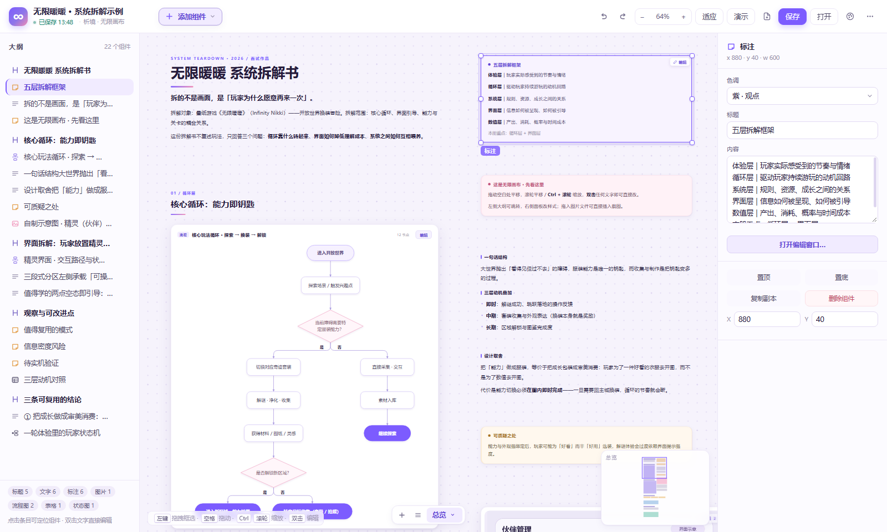
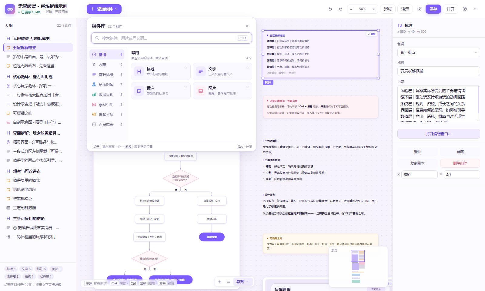
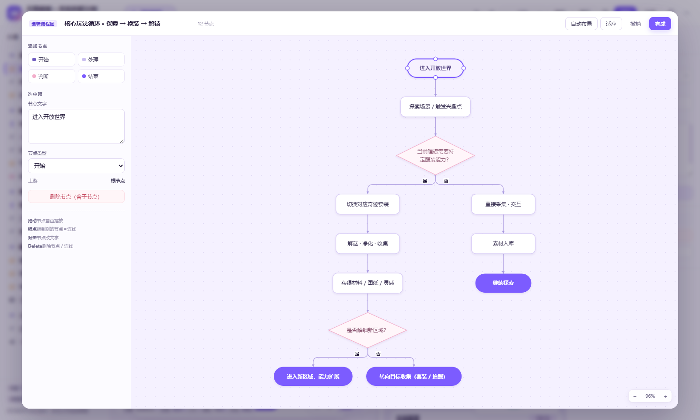
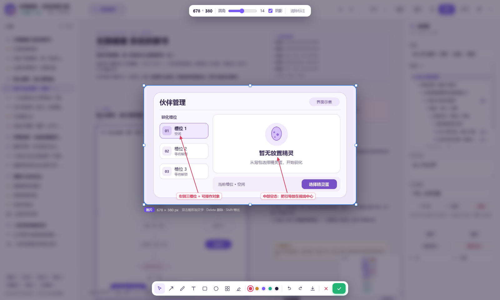

<p align="center">
  
</p>

<h1 align="center">析境 · 可视化拆解工作台</h1>

<p align="center">
  
  
  
  
</p>

**析境（Xijing）** 是一个在本地运行的无限画布编辑器，用于撰写游戏系统拆解。可以把玩法循环、界面标注和设计观察放进同一份可编辑的拆解书，并按章节组织成多块画布。

*A local infinite-canvas editor for game system analysis, with editable flowcharts, image annotations, and portable board files.*

## 运行截图 Screenshots









## 功能 Features

- **无限画布与多画布**。支持平移、缩放、演示模式、大纲定位及画布新建、重命名和复制。
- **分类组件库**。提供 22 类组件，支持搜索、收藏、最近使用，以及点击或拖拽添加。
- **图解与卡片编辑**。流程图、状态图、时间轴、循环图、层级图、矩阵、对比卡和数据卡片均有编辑窗口。
- **多选与分组**。支持框选、加选、整体拖动和分组框，便于组织复杂的拆解内容。
- **图片标注**。拖入或粘贴图片，使用箭头、文字、矩形、画笔和马赛克标记界面细节。
- **本地存档与文件交换**。浏览器内自动保存和历史快照，可导出包含画布、样式和图片的 `.nkdraw` 文件，也可打开旧版 `.json`。
- **模板与主题**。从空白画布、章节骨架或内置示例开始，切换五套配色。

## 下载 Download

通过 GitHub 的 **Code → Download ZIP** 下载整个仓库并完整解压，然后双击 `启动器/Xijing.exe`。

仓库已包含 Windows 启动器及其 `_internal` 运行依赖。请保留完整目录结构，启动器会自动找到项目首页并打开浏览器。

## 从源码运行 Run from Source

通过 GitHub 的 **Code → Download ZIP** 下载并解压，或使用 Git 克隆：

```sh
git clone https://github.com/xiaolizi0v0/xijing.git
cd xijing
```

在装有 Python 3 和 Tkinter 的电脑上，从项目根目录启动：

```sh
python launcher.py
```

启动器会打开默认浏览器，并在 `127.0.0.1:8763` 提供本地服务。端口被占用时会尝试后续端口。前端无需安装 npm 依赖或执行构建。

也可以用 Python 启动静态服务，然后在浏览器访问 `http://127.0.0.1:8763`。

```sh
python -m http.server 8763 --bind 127.0.0.1
```

建议用 Chrome 或 Edge 在本地服务地址打开项目，以便选择文件位置并续写同一份 `.nkdraw`。在不支持直接写文件的浏览器中，仍可通过 **更多 → 导出 .nkdraw 文件** 下载。

## 构建 Windows 启动器 Build

Windows 可执行文件由 MIT 许可的 [`launcher.py`](launcher.py) 构建。使用 Windows x64 版 Python 3.13.7（安装时包含 Tcl/Tk），在项目根目录执行：

```powershell
python -m venv .venv
.\.venv\Scripts\python.exe -m pip install -r .\scripts\requirements-build.txt
.\scripts\build-windows.ps1 -Python .\.venv\Scripts\python.exe
```

生成的 `dist/xijing-windows-x64.zip` 包含启动器、网页、示例资源和第三方运行时许可。

## 上手 Usage

1. 从顶栏选择 **新建 → 示例拆解书** 查看内置案例，或选 **章节骨架** 开始自己的拆解。
2. 点击左侧大纲定位组件。空白处拖拽可框选，按住空格拖动可平移，用 `Ctrl + 滚轮` 缩放，双击文字直接编辑。
3. 用底部 **+** 新建画布。完成后选择 **保存** 或按 `Ctrl + E` 导出 `.nkdraw` 文件。

完整操作、快捷键和文件格式见[使用说明](使用说明.md)。

## 许可 License

项目源码、文档和自制示例素材采用 [MIT License](LICENSE)。《无限暖暖》为案例分析对象，本项目是个人作品。相关游戏名称及商标归各自权利人所有。
